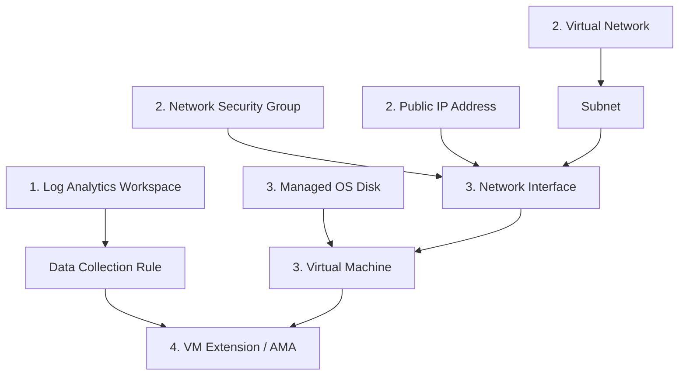

# Azure Multi-Format IaC Exporter & Dependency Architecture Guide

A production-ready, zero-dependency tool to extract deployed Azure resources into **ARM Templates**, **Bicep Templates**, and **Terraform Configurations** with parameter files, dependency management, state caching, and hierarchical folder organization.

---

## 🚀 Quick Start

### 1. Requirements
- Python 3.8+ (No external `pip` packages required; uses 100% standard library)
- Azure CLI (`az`) installed and authenticated (or credentials configured in `.env`)
- Azure CLI extensions (automatically managed by the tool):
  - `az bicep`
  - `az extension add --name terraform`

### 2. Basic Commands

```bash
cd azure-iac-exporter

# 1. Run discovery scan (generates scan_inventory.json with resource counts & types)
./run.sh --scan

# 2. Launch interactive wizard (numbered selection: 1, 2, 5...)
./run.sh --configure

# 3. Export specific resource group in all formats
./run.sh --subscription "Visual Studio Enterprise Subscription" --resource-group "Sentinel" --format all

# 4. Export only Bicep and parameters for a resource group
./run.sh --resource-group "Sentinel" --format bicep

# 5. Export all resource groups across all subscriptions (batch mode)
./run.sh --all

# 6. Skip unchanged resource groups using state cache
./run.sh --all --skip-unchanged
```

---

## 📂 Output Directory Hierarchy

Templates are organized hierarchically matching Azure's governance structure:

```
exports/
└── <Customer-or-Tenant-Name>/        # e.g., "LODS-Prod-MCA" or Tenant ID
    └── <Subscription-Name>/          # e.g., "Visual Studio Enterprise Subscription"
        └── <Resource-Group>/         # e.g., "Sentinel"
            │
            ├── arm/                  # ARM Template & Parameters
            │   ├── template.json     # Consolidated resource template with DAG dependencies
            │   └── parameters.json   # Parameter schema with default values
            │
            ├── bicep/                # Bicep Template & Parameters
            │   ├── main.bicep        # Declarative Bicep definition with symbolic references
            │   └── main.bicepparam   # Bicep parameters file (via az bicep generate-params)
            │
            ├── terraform/            # Terraform HCL Configuration
            │   ├── main.tf           # Terraform resources (azurerm provider)
            │   ├── providers.tf      # Provider requirements
            │   └── terraform.tfvars  # Input variables
            │
            └── metadata.json         # Resource inventory, categories & deployment sequence
```

---

## 🏗️ Architectural Guide: Managing Interdependent Resources for Redeployment

### The Challenge with Mixed Resource Groups
In Azure, a single Resource Group often contains mixed, interdependent resources:
- **Compute**: Virtual Machines (VM), Managed Disks (OS & Data), VM Extensions.
- **Networking**: Virtual Networks (VNet), Subnets, Network Interfaces (NIC), Network Security Groups (NSG), Public IPs (PIP).
- **Observability**: Log Analytics Workspaces (LAW), Data Collection Rules (DCR), Diagnostic Settings.
- **Security**: Azure Key Vault, User-Assigned Managed Identities, Role Assignments.

If these resources are exported blindly or individually, **redeployment fails** due to broken dependency ordering (e.g. attempting to deploy a VM before its Subnet or NIC exists).



---

### Strategy 1: RG-Level Consolidated Deployment (Automated & Immediate)
- **Concept**: Export the entire Resource Group as a unified template (`arm/template.json`, `bicep/main.bicep`, or `terraform/main.tf`).
- **Why It Works**: 
  - Azure Resource Manager and Terraform natively construct the **Directed Acyclic Graph (DAG)** of dependencies.
  - In ARM/Bicep, symbolic references (`networkInterface: { id: nic.id }`) and explicit `dependsOn` arrays enforce the exact topological creation order.
  - In Terraform, resource attribute cross-references (`resource_group_name = azurerm_resource_group.res-1.name`) ensure dependent resources are provisioned in order.
- **Best For**: Direct environment duplication, DR failover, backup/restore.

---

### Strategy 2: Modular Multi-Tier Staging (Enterprise Golden Standard)
For production landing zones and multi-environment promotion (Dev $\rightarrow$ Stage $\rightarrow$ Prod), split the resources into 4 sequential deployment layers:

| Layer | Resources | Why It Must Be Sequenced |
| :--- | :--- | :--- |
| **01 - Foundations & Observability** | Log Analytics Workspace, Key Vault, Diagnostic Storage | Foundational; logging endpoints and secret stores must exist before compute or network diagnostics can bind to them. |
| **02 - Network & Perimeter** | VNet, Subnets, NSGs, Route Tables, NAT Gateways, Public IPs | Must be established before NICs can attach. Subnets cannot be modified or destroyed while NICs are actively bound. |
| **03 - Workload & Compute** | Managed Disks, NICs, Virtual Machines, Availability Sets | NICs bind to Subnets and NSGs; Disks and NICs attach to VMs during VM creation. |
| **04 - Extensions & Diagnostics** | Azure Monitor Agent (AMA), Custom Script Extensions, Diagnostic Settings | Must be applied after the VM guest OS and network stack are fully running and reachable. |

---

### 📋 Portability & Redeployment Hygiene Checklist
Before executing redeployment on a target subscription or environment:

1. **Replace Static Resource IDs with Dynamic Functions**:
   - *Issue*: Exported templates often contain static IDs: `/subscriptions/a2e6a0ac-.../resourceGroups/Sentinel/...`.
   - *Fix*: Use `resourceId('Microsoft.Network/virtualNetworks', ...)` in ARM, symbolic resource references `vnet.id` in Bicep, or `azurerm_virtual_network.vnet.id` in Terraform.
2. **Externalize Sensitive Secrets**:
   - *Issue*: Azure strips all passwords, SSH keys, and secret values during export.
   - *Fix*: Declare secure parameters (`@secure()` in Bicep, `type: securestring` in ARM, `sensitive = true` in Terraform) referencing Azure Key Vault secrets.
3. **Strip Read-Only & Ephemeral Attributes**:
   - *Issue*: Properties such as `provisioningState`, `etag`, and `vmId` are read-only and will cause deployment errors.
   - *Fix*: The exporter strips extraneous properties, but always verify custom resource bodies.
4. **Subnet Modification Locking**:
   - *Issue*: Azure does not permit modifying a subnet while NICs are connected to it.
   - *Fix*: Always deploy all Subnets simultaneously during the VNet definition before provisioning NICs.

---

## ⚙️ CLI Reference Options

| Flag | Description |
| :--- | :--- |
| `--scan` | Discovers all subscriptions, RGs, resource counts, and types; outputs `scan_inventory.json`. |
| `--configure` | Launches the interactive wizard with numbered selection. |
| `--all` | Crawls all subscriptions and resource groups in batch mode. |
| `--subscription <id/name>` | Filters to a specific subscription ID or name. |
| `--resource-group <name>` | Filters to a specific resource group. |
| `--format <arm\|bicep\|terraform\|all>` | Selects export format (default: `all`). |
| `--output-dir <path>` | Root export path (default: `./exports`). |
| `--customer-name <name>` | Overrides top-level folder name (defaults to Tenant Name or ID). |
| `--rules <path>` | Uses a custom declarative sanitizer rules JSON file (defaults to `sanitizer_rules.json`). |
| `--skip-unchanged` | Checks resource hashes against `.export_state.json` to skip unchanged RGs. |
| `--force` | Bypasses state cache and re-exports everything. |

---

## 🧹 Declarative Resource Sanitization & Filtering (`sanitizer_rules.json`)

To prevent exported templates from blowing up with hundreds of empty system-generated tables (e.g., Microsoft Sentinel's 850+ internal solution tables) or colliding with Terraform provider declarations, the tool includes a rule-driven sanitization engine.

All filtering rules are managed in **`sanitizer_rules.json`**—**no Python code modifications required**.

### Adding Future Filters Without Code Changes
Whenever you encounter any other Azure resource you do not want exported (e.g. Network Watcher, default NSG rules, system diagnostics), simply add a rule to `sanitizer_rules.json`:

```json
{
  "id": "filter-network-watchers",
  "description": "Do not export default Network Watchers",
  "enabled": true,
  "arm": {
    "resourceType": "Microsoft.Network/networkWatchers",
    "action": "prune"
  },
  "bicep": {
    "resourceType": "Microsoft.Network/networkWatchers",
    "action": "prune"
  },
  "terraform": {
    "resourceType": "azurerm_network_watcher",
    "action": "prune"
  }
}
```

- **`enabled` Toggle**: Easily enable or disable rules by toggling `"enabled": true/false`.
- **`unless` Exceptions**: Protects genuine custom resources (e.g., custom tables ending in `_CL` or containing custom `columns: [...]` schemas).

---

## 🔒 Security & Isolation
- **Completely Isolated**: Operates strictly within `./azure-iac-exporter/` without touching any parent project files.
- **Zero Credentials in Git**: Output folders and state files are included in `.gitignore`.
- **Seamless Auth**: Auto-detects existing `az account` sessions or falls back to Service Principal in parent `.env`.
